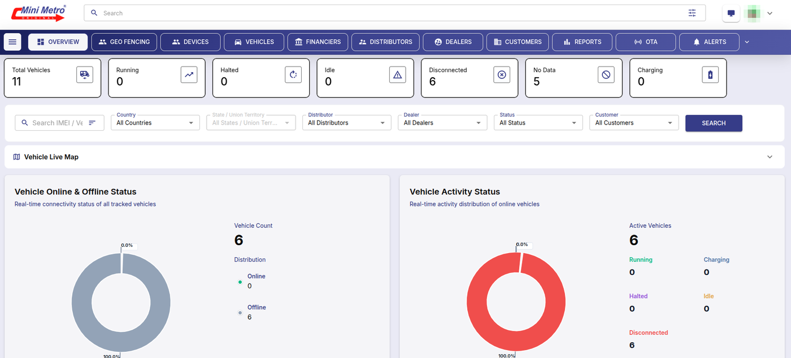
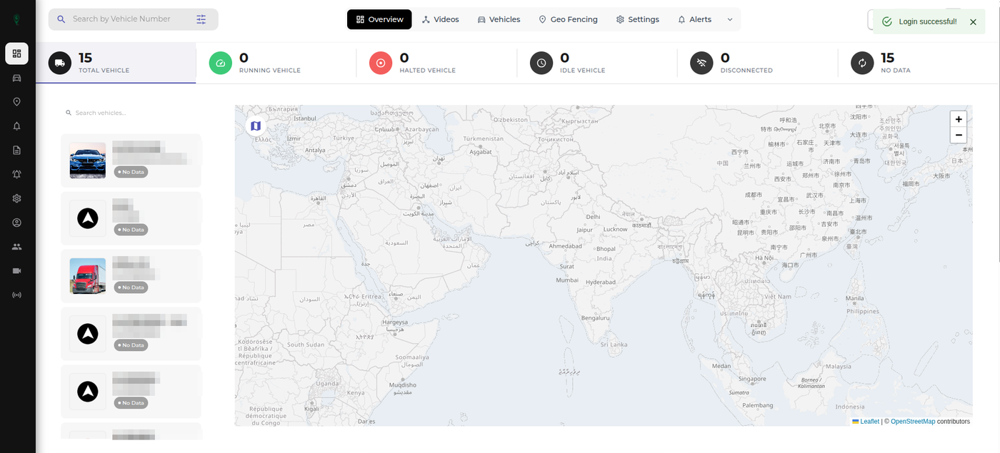
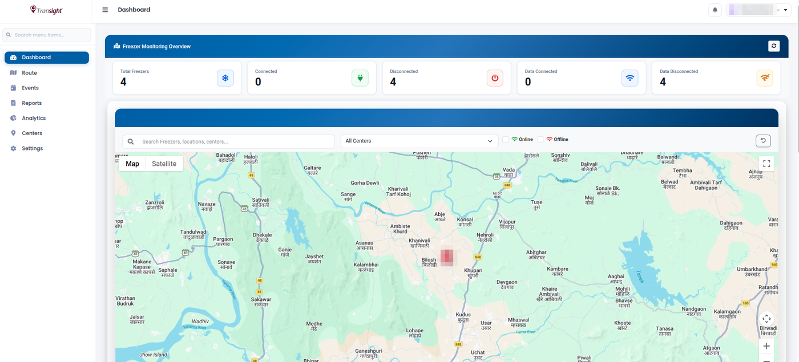
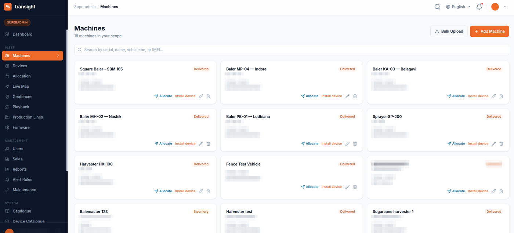

<h1>Akshay Raj</h1>

  
  

    
 

---

## About

I am a software engineer who builds web applications for connected-device platforms: real-time monitoring dashboards, device workflows and API-driven interfaces. My professional work covers M2M and IoT, video telematics, fleet management, GPS tracking and cold-chain monitoring.

My day-to-day focus is frontend engineering with React.js and TypeScript. My personal and academic projects add Angular, Flutter, Django REST Framework and PHP, so I understand how a full application fits together: interface, API, database and workflow rules.

Role: Associate Software Engineer, Transight Systems Pvt. Ltd., since September 2024
Recognition: Rising Star Award, May 2025
Looking for: Software Engineer, Frontend Developer, React Developer, Angular Developer and Full-Stack Developer roles in Australia, Europe and international remote teams
CV: Download PDF

---
## Technical Skills
 
### 1. Frontend Development

 
**Additional Skills:** Responsive UI Development, Reusable Component Architecture, State Management, Redux, Dashboard Development, Data Visualization, UI Optimization.
 
### 2. Programming Languages

 
### 3. Backend Development

 
**Additional Skills:** Backend API Integration, Authentication, Token-Based Authentication, Request/Response Handling, Server-Side Application Integration.
 
### 4. Database Management

 
**Additional Skills:** Database Integration, SQL Queries, Data Management, Relational Database Operations, Caching.
 
### 5. API Development & Integration

 
**Additional Skills:** RESTful API Integration, HTTP Methods, API Testing, JSON Data Handling, Authentication Headers, API Debugging, Frontend–Backend Communication.
 
### 6. Maps, GPS & Telematics

 
**Additional Skills:** GPS Tracking, Geospatial Data Integration, Live Vehicle Tracking, Asset Tracking, Fleet Monitoring, Location-Based Dashboards, Cold Chain Monitoring.
 
### 7. Mobile Application Development

 
**Additional Skills:** Cross-Platform Mobile Development, REST API Integration, HTTP Requests, Mobile UI Development.
 
### 8. Development Tools & Version Control

 
**Additional Tools:** VS Code, Git Branching, Merge Requests, Code Reviews, Postman.
 
### 9. Software Engineering & Development Practices
 
- Reusable Component Development
- Responsive Web Application Development
- Frontend Architecture and Optimization
- API Integration and Debugging
- Application Performance Optimization
- Troubleshooting and Bug Fixing
- Testing and Quality Assurance
- Agile / Scrum Methodology
- Jira Task Management
- Integration Testing and QA Handover
- Version Control and Collaborative Development
### 10. Professional Domain Experience
 
- Fleet Management Systems
- MiniMetro Asset Tracking
- GPS and Vehicle Tracking Systems
- Video Telematics
- Cold Chain and Freezer Monitoring
- Asset Management Systems
- Monitoring Dashboards and Data Visualization

## 💼 Professional Engineering Experience – Transight Systems

**Associate Software Engineer** | Transight Systems Pvt. Ltd. | September 2024 – Present

I build and maintain web interfaces for enterprise IoT and telematics products: reusable frontend components, REST API integration, monitoring dashboards and data-driven views, working with cross-functional engineering teams.

> **Confidentiality:** These are employer products, not open-source projects. No proprietary code, endpoints, customer data or internal documentation are published here. Screenshots are interface views with identifying details blurred. The cards describe the interface and my engineering areas only.

<table>
<tr><td>

### MiniMetro – Asset Tracking and Vehicle Management

MiniMetro overview: vehicle status counts, hierarchy filters and connectivity charts.

**What the interface covers**
<ul>
<li>Overview, Geo Fencing, Devices, Vehicles, Financiers, Distributors, Dealers, Customers, Reports, OTA and Alerts modules</li>
<li>Vehicle status counts: running, halted, idle, disconnected, no data and charging</li>
<li>Filters by country, state, distributor, dealer, status and customer, and search by IMEI or vehicle</li>
<li>Live map section and charts for online or offline status and vehicle activity</li>
</ul>

**My engineering areas:** Web interface development and REST API integration

</td></tr>
</table>

<table>
<tr><td>

### Compass Revamp / RevMap – Fleet Management and GPS Tracking

Compass overview: fleet status counts, vehicle list and map view. Vehicle identifiers are blurred.

**What the interface covers**
<ul>
<li>Overview with counts of total, running, halted, idle, disconnected and no-data vehicles</li>
<li>Searchable vehicle list with live status</li>
<li>Map view built with Leaflet and OpenStreetMap, as shown in the map attribution</li>
<li>Sections for Videos, Vehicles, Geo Fencing, Settings and Alerts</li>
</ul>

**My engineering areas:** Mapping and geospatial interfaces, vehicle tracking and route visualization, fleet-related monitoring, interactive data-driven dashboards

</td></tr>
</table>

<table>
<tr><td>

### Cold Chain and Freezer Monitoring

Freezer monitoring overview: connection status counts and map. Customer name and freezer location are blurred.

**What the interface covers**
<ul>
<li>Counts of total, connected, disconnected, data-connected and data-disconnected freezers</li>
<li>Map with Map and Satellite views</li>
<li>Search by freezer, location or center, a center filter, and online or offline filters</li>
<li>Sections for Route, Events, Reports, Analytics, Centers and Settings</li>
</ul>

**My engineering areas:** Device telemetry and status visualization, temperature and monitoring dashboards, device connectivity and status investigation, API integration and frontend data handling, troubleshooting monitoring discrepancies

</td></tr>
</table>

<table>
<tr><td>

### Shaktiman – Machinery Fleet Management

Shaktiman machines page: inventory with lifecycle status and device actions. Device identifiers are blurred.

**What the interface covers**
<ul>
<li>Machine inventory with Inventory and Delivered statuses, bulk upload and search by serial, name, vehicle number or IMEI</li>
<li>Allocate and install-device actions on each machine</li>
<li>Fleet modules: devices, allocation, live map, geofences, playback, production lines and firmware</li>
<li>Management modules: users, sales, reports, alert rules and maintenance, plus a product catalogue and device catalogue</li>
<li>Machine types shown include balers, sprayers and harvesters</li>
</ul>

**My engineering areas:** Web interface development and REST API integration

</td></tr>
</table>

**Other platforms**

<table>
<tr><th>Product</th><th>Domain</th><th>Engineering areas</th></tr>
<tr>
<td><b>M2M Platform</b></td>
<td>Machine-to-machine communication and IoT</td>
<td>React.js and TypeScript frontend, API integration and backend communication, device monitoring and management workflows, dashboards and data visualization, frontend architecture and reusable components</td>
</tr>
<tr>
<td><b>Video Telematics Platform</b></td>
<td>Video telematics</td>
<td>Video gallery and monitoring interfaces, video-related API integration, frontend and backend communication, monitoring workflows and user interface improvements</td>
</tr>
<tr>
<td><b>Fleet Management Platform</b></td>
<td>Fleet monitoring</td>
<td>Vehicle tracking interfaces, interactive dashboards, API-driven data presentation, responsive frontend development</td>
</tr>
<tr>
<td><b>Joy eBike Tracking Platform</b></td>
<td>Tracking platform for electric bikes</td>
<td>Web interface development and REST API integration</td>
</tr>
</table>

---

## Personal and Academic Projects

Each project has a documentation page with architecture, a directory tree, a database diagram and a data-flow description. Everything on those pages comes from the repository files.

<table>
<tr><td>

### [PLEXA – Placement App](https://github.com/akshayrajar174/PLEXA) ([architecture and docs](docs/PLEXA.md))

A mobile placement-management app that connects students, companies and a Training and Placement Officer. Final-year MCA project, April 2024, with a project report listing me as the author.

**Stack:** Flutter (Dart), Provider, Django REST Framework (Python), token authentication, SQLite

**Highlights**
<ul>
<li>Three-role system built on a custom Django user model</li>
<li>Server-enforced workflow: apply (duplicates blocked), approve or reject, then schedule an interview only for approved applications</li>
<li>Feature-first Flutter structure with a view and a controller for each screen</li>
</ul>

</td></tr>
</table>

<table>
<tr><td>

### [GBOX – Gaming Store](https://github.com/akshayrajar174/GBOX) ([architecture and docs](docs/GBOX.md))

An online store for games and gaming accessories, built with Angular. Repository created March 2024.

**Stack:** Angular 16, TypeScript, RxJS, SheetJS (`xlsx`), MySQL-compatible SQL schema

**Highlights**
<ul>
<li>Twelve-table schema covering catalogue, cart, orders, payments, delivery and locations</li>
<li>Product hierarchy of category, subcategory and product</li>
</ul>

</td></tr>
</table>

<table>
<tr><td>

### [Complaint Management System](https://github.com/akshayrajar174/Complaint-management-system) ([architecture and docs](docs/Complaint-management-system.md))

A web portal where college students and staff register complaints and administrators process them. BCA project, February 2022, completed as a team of three.

**Stack:** PHP, MySQL, HTML, CSS, JavaScript

**Highlights**
<ul>
<li>Separate user and admin portals over one MySQL database</li>
<li>Complaint lists by status, remarks and user login logs</li>
</ul>

</td></tr>
</table>

**Learning projects:** a [React notes app](https://github.com/akshayrajar174/ShapeAI_Bootcamp_JSANDRJS) from a JavaScript and React bootcamp, and a [Python machine learning notebook](https://github.com/akshayrajar174/ShapeAi_Python_Machine_Learning) from a bootcamp (2021).

---

## GitHub Analytics

<!--
Optional, once project source is unzipped into the repositories so the language data is meaningful:

-->

---

## Achievements

- **Rising Star Award**, Transight Systems Pvt. Ltd., May 2025

## Education

- **Master of Computer Applications (MCA)**, Mahatma Gandhi University, Kottayam, 2022 – 2024
- **Bachelor of Computer Application (BCA)**, Mar Sleeva College of Arts and Science, Idukki, Kerala (Mahatma Gandhi University)

## Career Interests

Frontend architecture, full-stack web development, scalable web applications, API integration, IoT and telematics, real-time data visualization and software engineering best practices. Open to roles in Australia, Europe and remote teams.

---

## Connect

     

